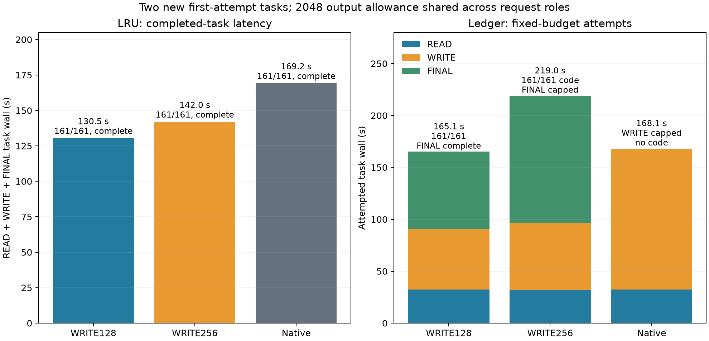

# New practical tasks

**LRU completed 22.88% faster with WRITE budget 128 and 16.09% faster with 256 than native**, with 161/161 checks passing in every arm. Ledger 128 completed with correct code; native exhausted the fixed output allowance before writing code. Ledger 256 wrote correct code but exhausted the allowance in FINAL. Capped attempt times are not comparable completed-task speedups.

| Task / arm | Task attempt wall, s | First code | Whole pipeline | READ / WRITE / FINAL thinking | Forced / deferred |
|---|---:|---|---|---|---|
| Ledger 128 | 165.109 | 161/161 | complete, pass | 19 / 128 / 430 | 1 / 0 |
| Ledger 256 | 218.963 | 161/161 | FINAL capped | 19 / 256 / 1362 | 1 / 0 |
| Ledger native | 168.120 | no write | WRITE capped | 19 / 1933 / — | 0 / 0 |
| LRU 128 | 130.473 | 161/161 | complete, pass | 20 / 128 / 0 | 1 / 0 |
| LRU 256 | 141.966 | 161/161 | complete, pass | 20 / 256 / 0 | 1 / 0 |
| LRU native | 169.190 | 161/161 | complete, pass | 20 / 600 / 0 | 0 / 0 |



| Task / arm | READ HTTP, s | WRITE HTTP, s | FINAL HTTP, s |
|---|---:|---:|---:|
| Ledger 128 | 32.207 | 58.508 | 74.392 |
| Ledger 256 | 31.896 | 64.928 | 122.137 |
| Ledger native | 32.472 | 135.646 | — |
| LRU 128 | 31.693 | 53.541 | 45.236 |
| LRU 256 | 31.672 | 60.002 | 50.289 |
| LRU native | 31.450 | 78.524 | 59.214 |

Both positive arms forced each WRITE exactly once at its configured count; all 17 request summaries report zero deferrals. Every task actually read its config. Every completed WRITE preserved and graded its first code; no repair was attempted. READ/FINAL budgets stayed 0 with high thinking enabled. The 1362 FINAL thinking tokens on ledger 256 show that a WRITE-only limit does not bound the remaining workflow.

Summed attempted task wall was 295.581/360.928/337.310 s for 128/256/native, with completed pipelines 2/2, 1/2, 1/2. Those sums include different failures and are not equal-work latency comparisons. These are single executions per new task/arm, without native brackets or a general reliability estimate.

The [frozen fixtures and independent reference checks](practical/check-results.json) contain 161 inputs per task: a sample, 16 edges and 144 deterministic random cases. Ledger's exhaustive revision/position oracle is checked against incremental winners; LRU timestamps against a queue. Model-visible contracts are in [spec.json](practical/spec.json); private golds are never advertised.

Method: unchanged item16 runtime `bc6896ae` ([build/SHA record](build.json)), new cache/store per arm, Q2/cache64/ctx8192/chunk512, temperature 0/high thinking, suffix off/GAP0, shared 2048 output allowance per task. Nonzero budget also disables MTP for that request. Task wall includes actual HTTP read/write/final I/O, excluding startup and external grading. Usage excludes EOS; public completion is not an independent EOS observation. Divergent generated histories receive no paired NLL/KL.

Analysis command:

```sh
.workspaces/bench-plots-venv/bin/python -B speed-bench/experiments/server-confirmation-hour17-20261004/practical_analyze.py --input speed-bench/experiments/server-confirmation-hour17-20261004/practical-http --output speed-bench/experiments/server-confirmation-hour17-20261004/practical-analysis --plot
```

[Guard](pressure-practical/result.json) completed with code 0: 966 samples, all level 1, no bad streak, swap stable 0.012998 GiB, peak wired+compressor 83.883 GiB. [CSV](practical-analysis/practical-results.csv), [JSON/force summaries](practical-analysis/practical-results.json), [SVG](practical-analysis/practical-pareto.svg), [recorded command](pressure-practical/command.json) and [raw HTTP arms](practical-http) retain all first outcomes. Keep the feature opt-in; this screen favors 128 on these tasks while exposing unbounded FINAL work.
