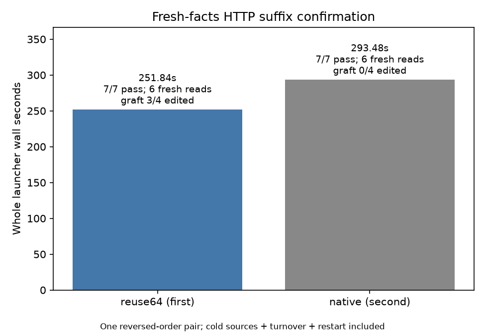

# Fresh-facts HTTP suffix confirmation

Reuse64 saved **18.48% across the four edited turns** and **14.19% of whole
launcher wall time**. Both arms passed all seven steps, including six actual
file reads; the three observed grafts include one approximate SSD source
after restart. This is one reversed-order pair, reuse64→native, with new facts
in the existing workflow family.

| Timed scope | Native seconds | Reuse64 seconds | Saving |
|---|---:|---:|---:|
| Cold source A+B | 99.837410 | 92.498151 | 7.35% |
| Ordinary A/B deletion | 96.991570 | 75.703763 | 21.95% |
| Changed archives after restart | 90.251296 | 76.944941 | 14.74% |
| All four edited turns | 187.242866 | 152.648704 | 18.48% |
| C slot-turnover request | 2.304238 | 2.496704 | −8.35% |
| All seven task steps | 289.384513 | 247.643559 | 14.42% |
| Steps excluding source warmup | 189.547104 | 155.145408 | 18.15% |
| Server startup + restart | 0.838470 | 0.844837 | −0.76% |
| Whole launcher wall | 293.479672 | 251.839290 | 14.19% |

Edited latency includes the actual file/context edits; task-step sums exclude
server startup, shutdown and driver overhead. Whole launcher wall includes
them. Cold source latency differed by 7.35% despite having no graft, so that
difference is reported separately and is not attributed to suffix reuse.

The independent answers are A=`23*14−9=313`, B=`31*8−17=231`. The first archive
labels are `BEACON-46`/`ORBIT-57`; after restart the actual files change to
`BEACON-47`/`ORBIT-58`. Each edited answer requires a new whole/raw file read.
Old marked dispatch notes are deleted, while active tool results remain.
All responses completed; incorrect, capped or fallback points would remain
in the aggregate.

| Reuse64 edited step | Seconds | Reused tokens | Actual fresh tokens | Source | Result |
|---|---:|---:|---:|---|---|
| A-edit1 | 40.306265 | 416 | 726 (662+64) | SSD, native | pass |
| B-edit1 | 35.397498 | 527 | 102 (38+64) | SSD, native | pass |
| A-edit2 after restart | 30.903844 | 786 | 242 (178+64) | SSD, approximate | pass |
| B-edit2 after restart | 46.041097 | 0 | no graft | `no-aligned-source` fallback | pass |

Graft coverage is 3/4 edited steps, not a task-pass condition. B-edit2's logged
reason is `no-aligned-source`; the logs do not establish a more specific
alignment cause. Native has no suffix grafts. The nominal fresh-tail setting
is 64; actual fresh work is larger where the selector protects additional
history. Generated histories can differ, so there is no paired NLL/KL or
general accuracy claim.

Runtime: `bc6896aeee2aceba4b4b64e9e8330986da8a60b0`, unchanged from item16,
as recorded in [build.json](build.json). Both arms use Responses full input,
`store:false`, effort none, temperature 0, resident GAP 0, ctx 8192, chunk 512,
expert cache 64GB, selected64/1024, two session slots and SSD hot tier 0. The
same absolute advertised paths are reset for both arms; each has a separate
new cache/store. Any sent Responses seed is ignored.

The external guard completed with child 0: 527/527 normal samples, no adverse
samples, zero swap growth (initial/final 0.012998 GiB), peak wired+compressor
84.204147 GiB. See [guard result](pressure-suffix/result.json),
[pressure samples](pressure-suffix/pressure.jsonl) and
[exact guard command](pressure-suffix/command.json).

Run: Framework Python `-B suffix_sweep.py --timeout 600`, from repo root under
one pressure guard. Per-arm commands and environment are retained in
[sweep execution](suffix-http/sweep-execution.json) and the arm execution
files. Analysis used the existing hour14 `http_analyze.py --input
speed-bench/experiments/server-confirmation-hour17-20261004/suffix-http
--output speed-bench/experiments/server-confirmation-hour17-20261004/suffix-analysis
--plot` with the existing plotting venv after timing release.

[Compact JSON](suffix-summary.json), [CSV](suffix-summary.csv),
[detailed rows](suffix-analysis/summary.json),
[scope-separated latency plot](suffix-analysis/http-latency.png).

