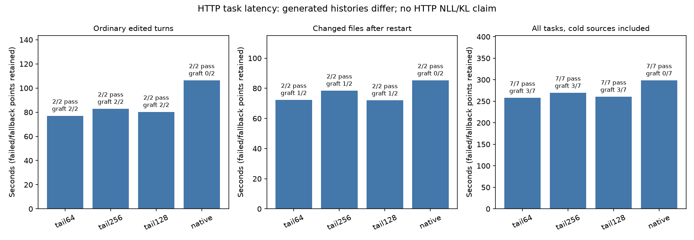

# HTTP suffix fresh-tail curve

All four arms completed **7/7 steps correctly, including six actual fresh file reads each**. Reuse with fresh-tail lower bound 64 saved **27.59% on ordinary edited turns**, **15.27% on changed-file turns after restart**, and **13.67% across all seven task steps including cold sources**. The corresponding all-task savings were 9.68% for 256 and 12.78% for 128. This is one fixed, reverse-order sweep: **reuse64 → reuse256 → reuse128 → native**, runtime `3fb450f7`.

The unchanged [hour12 launcher](../server-workflow-hour12-20261004/launch.py) ran two server lifetimes per arm, with separate initially cold SSD caches and the same absolute visible paths under `.workspaces/server-agent-day-20261004/workflow-shared`. Each arm reset the source files. A/B read real inventory files, then archive files after two context deletions; C exercises slot turnover. Independent answers are A=416 and B=202, with old archive codes RIVER-73/CEDAR-91 followed by updated RIVER-74/CEDAR-92 after restart. All fallback points remain included.

## Measured latency

Seconds; parentheses show savings relative to the final native arm. Step sums include file writes and context edits, and exclude server startup/shutdown. Cold source capture/cache work is included in source warmup and all-task sums.

| Measurement | Native | Tail 64 | Tail 256 | Tail 128 |
| --- | ---: | ---: | ---: | ---: |
| Cold sources A+B | 104.662 | 106.111 (−1.38%) | 106.177 (−1.45%) | 105.959 (−1.24%) |
| Ordinary edits A+B | 106.386 | 77.036 (27.59%) | 82.860 (22.11%) | 80.253 (24.56%) |
| Changed files after restart A+B | 85.286 | 72.261 (15.27%) | 78.444 (8.02%) | 71.980 (15.60%) |
| All four edited turns | 191.671 | 149.297 (22.11%) | 161.304 (15.84%) | 152.233 (20.58%) |
| All seven task steps | 298.581 | 257.780 (13.67%) | 269.666 (9.68%) | 260.435 (12.78%) |
| Excluding cold sources, including C | 193.919 | 151.669 (21.79%) | 163.488 (15.69%) | 154.476 (20.34%) |

Whole-launcher wall time, including both server lifetimes, startup/shutdown and cache work, was **303.483s native**, **264.243s tail64**, **273.951s tail256**, **264.790s tail128** (12.93%, 9.73%, 12.75% savings). Recorded server startup/restart totals were 0.844s, 3.135s, 0.830s and 0.841s respectively. Source warmup is not silently excluded from the whole-task result.

## Actual geometry and retained fallback

Each reuse arm activated three grafts across four edited turns: both ordinary edits and A after restart. All three sources came from SSD; the after-restart A source was already approximate. B-edit2 used exact fallback (`no-aligned-source`) for **every reuse arm**, taking 43.217/43.229/43.239s for 64/256/128, and still retrieved the updated file correctly. Native activated no grafts.

| Arm | A-edit1 reused / actual fresh | B-edit1 reused / actual fresh | A-edit2 reused / actual fresh | Edited graft coverage |
| --- | --- | --- | --- | --- |
| Tail 64 | 563 / 784 | 591 / 99 | 841 / 231 | 3/4 |
| Tail 256 | 563 / 784 | 335 / 355 | 585 / 487 | 3/4 |
| Tail 128 | 563 / 784 | 463 / 227 | 841 / 231 | 3/4 |

The configured tail is a **lower bound**, not the total reevaluation size. The query/latest-user geometry limits reuse: tail64 still evaluated 99–784 fresh tokens at its grafts. Full staged/final fresh counts, source ranges, exact-cache hits and slot-eviction lines are preserved in [analysis JSON](http-analysis/summary.json).

## Controls and interpretation

The single [pressure guard](http-guard/result.json) completed with child 0: **1,069 normal samples**, zero adverse samples, zero swap growth, peak wired plus compressor **85.083847 GiB**. Swap stayed at 0.012998 GiB. No unrelated analysis or plotting ran during final timings.

These are four current-runtime arms on the same two small file-backed tasks, measured once in the stated order. Generated histories and serialized tool replies can differ; **this HTTP curve has no paired NLL/KL claim** and is separate from the fixed-token core curve. Any seed sent by the existing Responses driver is ignored, so no seed reproducibility is claimed. All observed grades passed, but this does not establish general task accuracy, physical SSD-read savings or balanced serving throughput. Reuse remains opt-in.

ROOT's exact child command is in [guard command.json](http-guard/command.json); [sweep execution](http/sweep-execution.json), per-arm command files and before/after server execution files retain actual argv, cache paths, settings and environment. [CSV](http-analysis/summary.csv) contains exact latency ratios; full requests/replies and individual outcomes remain in each arm's `http/{before,after}/result.json`.

