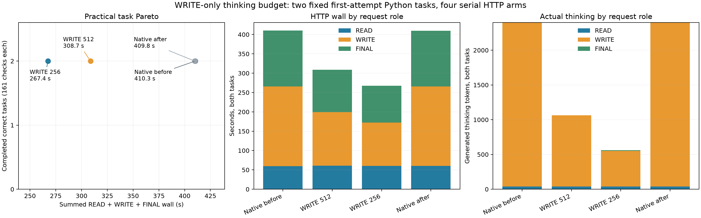

# Server WRITE thinking budget

**Budget 256 saved 34.78% of READ→WRITE→FINAL task time; budget 512 saved 24.72%.** All eight first implementations passed 161/161 checks and the tool contract, with no global output caps. These are two previously used tasks, not a general accuracy guarantee.

| Arm | Two-task wall, s | Change vs native bracket mean | Practical tasks | READ / WRITE / FINAL thinking tokens | Total output tokens | Forced / deferred |
|---|---:|---:|---|---|---:|---|
| Native before | 410.269 | baseline | 2/2, each 161/161 | 40 / 2357 / 0 | 3149 | 0 / 0 |
| WRITE 512 | 308.656 | −24.72% | 2/2, each 161/161 | 40 / 1024 / 0 | 1809 | 2 / 0 |
| WRITE 256 | 267.422 | −34.78% | 2/2, each 161/161 | 40 / 512 / 11 | 1321 | 2 / 0 |
| Native after | 409.786 | baseline | 2/2, each 161/161 | 40 / 2357 / 0 | 3149 | 0 / 0 |

Native mean is 410.027 s; the after bracket was 0.118% faster. Native first code bytes, final text and per-role usage matched for both tasks.



READ cost approximately 60 s per task pair in every arm. WRITE cost 206.2/138.7/112.1 s and FINAL 144.6/109.2/95.0 s for native-before/512/256. Shorter reasoning history also reduces FINAL time. Native WRITE thinking was 1613 join + 744 window tokens. Positive budgets forced once per WRITE, at exactly the requested count; all 24 request summaries have zero deferrals. READ/FINAL budget stays zero, leaving thinking enabled.

Method: [hour5 public contracts and graders](../confirmation-hour5-20261003/practical/README.md), stable left join and window argmax; one actual file READ, first-code WRITE, then FINAL. No repairs or retries. Stored response IDs preserve private reasoning; current stage instructions replace prior instructions. Task wall includes HTTP and file I/O, excluding startup/grading. Divergent histories have no paired NLL/KL.

Runtime `bc6896ae` ([build/SHA/test record](build.json)); four new cache/store lifetimes, Q2/cache64/ctx8192/chunk512, temperature 0/high thinking, TILE64/LIMIT1024/GAP0, suffix off. Seed is ignored. Shared per-task output allowance is 2048; usage includes forced closure and excludes EOS. Public `completed` status does not independently prove observed EOS.

Scope: `ds4_reasoning_budget` is a soft once-per-request close, counting generated non-control thinking. Unsafe DSML/last-slot deferral or later reopening/recovery can exceed it; the counter/once state survives recovery. Nonzero disables MTP for the whole request; zero keeps speculation. It is neither a WRITE detector nor a persisted conversation setting. Keep opt-in and qualify unused tasks before choosing defaults.

ROOT ran [the recorded launcher command](guard/command.json) beneath the existing MAIN pressure guard:

```sh
python3 -B speed-bench/ideas/pressure_run.py speed-bench/experiments/server-thinking-hour16-20261004/guard -- python3 -B speed-bench/experiments/server-thinking-hour16-20261004/launch.py --output speed-bench/experiments/server-thinking-hour16-20261004/http --global-cap 2048 --max-wall-seconds 1500
.workspaces/bench-plots-venv/bin/python -B speed-bench/experiments/server-thinking-hour16-20261004/analyze.py --input speed-bench/experiments/server-thinking-hour16-20261004/http --output speed-bench/experiments/server-thinking-hour16-20261004/analysis --plot
```

[Guard](guard/result.json): 1358 samples, all level 1, zero bad streak, stable swap 0.012998 GiB, peak wired+compressor 84.841 GiB. [CSV](analysis/results.csv), [JSON/native-repeat/force logs](analysis/results.json), [SVG](analysis/task-pareto.svg) and [raw HTTP records](http) retain the evidence.
