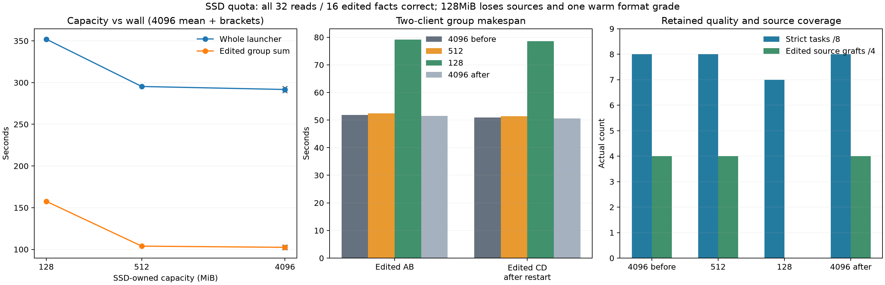

# SSD quota tradeoff

**512MiB retained all four suffix sources and task grades**, at a small observed cost of +1.23% whole wall versus the 4096MiB bracket mean. **128MiB lost every edited source**, raising whole wall 20.69% and edited wall 53.88%. All 32 actual file reads and 16 edited fact answers remained correct; one 128MiB warm response failed the strict READY-only format before any graft. No output cap was hit.

| Arm, measured order | Warm AB / CD, s | Edited AB / restarted CD, s | Client phases / whole launcher, s | Whole / edited vs4096 mean | Strict / reads / edited facts |
| --- | --- | --- | --- | --- | --- |
| 4096 before | 92.108 / 91.021 | 51.858 / 50.982 | 285.974 / 290.396 | −0.46% / +0.37% | 8/8 / 8/8 / 4/4 |
| 512 | 91.026 / 95.974 | 52.466 / 51.426 | 290.895 / 295.331 | +1.23% / +1.40% | 8/8 / 8/8 / 4/4 |
| 128 | 94.310 / 96.069 | 79.136 / 78.528 | 348.048 / 352.088 | +20.69% / +53.88% | 7/8 / 8/8 / 4/4 |
| 4096 after | 92.616 / 93.871 | 51.489 / 50.586 | 288.567 / 293.066 | +0.46% / −0.37% | 8/8 / 8/8 / 4/4 |

The 4096 bracket drift was +0.92% whole wall and −0.74% edited wall (warm AB +0.55%, CD +3.13%). Its public outputs and all response usage repeated exactly after excluding generated item/call IDs. The 512 arm also matched those outputs/usages. The 128 arm's Cwarm used 134 output tokens versus 95: 9 extra tool-call tokens and 30 extra final tokens. It returned correct inventory prose plus READY; the strict failure remains retained. Its longer history and final JSON spacing changes contribute to cost, so this is a capacity configuration screen rather than identical generated trajectories.



| SSD-owned data at close, before / after restart | MiB | Endpoints | Endpoint evictions in each lifetime | Logical disk chunk reads | Admission warnings |
| --- | --- | --- | --- | --- | --- |
| 4096 before control | 464.769 / 590.338 | 40 / 46 | 0 / 0 | 164 / 165 | 0 / 0 |
| 512 | 484.598 / 493.504 | 42 / 24 | 0 / 24 | 165 / 164 | 0 / 0 |
| 128 | 118.079 / 118.573 | 11 / 11 | 55 / 12 | 128 / 128 | 0 / 0 |
| 4096 after control | 484.598 / 610.167 | 42 / 48 | 0 / 0 | 165 / 165 | 0 / 0 |

Each shutdown's owned SSD data stayed below its configured cap; metadata is reported separately in JSON, and these counters are not physical directory allocation or SSD traffic. No admission warnings appeared in either lifetime's logs. 512 evicted 24 endpoints after restart while preserving the required old sources; 128 churned 67 endpoints and found no aligned edited source. Fewer logical read operations at 128 therefore do not imply less inference work or better storage latency. Hot reads, hot ownership and pinned endpoints were zero throughout the shutdown records. Slot checkpoint eviction logs were four per arm and are distinct from persistent endpoint evictions.

Both 4096 controls and 512 logged four pre-RoPE primary grafts from suffix-native SSD states (`source_approximate=0`): A/C source `660:1694`, B/D `658:1692`, destination `308:1342`, reused 1034/fresh 95. A/C selected pad 0, B/D pad 1. All four then retained approximate visible-prefix continuations, cached 1530/fresh 25–26, with no completion grafts. Each had four initial exact fallbacks.128 had zero grafts/approximate continuations and eight exact fallbacks; all four edited READ responses report cached_tokens0, including CD after restart, while the internal logs record four short256-token exact state-cache hits during synchronization. Those usage fields therefore do not imply that every prefix token was recomputed. Its final requests still reused ordinary native token prefixes. Group log slices are counted once; individual row log arrays intentionally avoid concurrent double counting.

Whole launcher includes server startup, both client phases and shutdowns; group makespan measures completion of two in-flight clients, not the sum of their queue-inclusive waits or parallel GPU throughput. The workload has four histories, two resident slots and one authored edit per history, then restart before CD. All changed-file facts, including CEDAR-70/DELTA-83, passed independent gold checks. It does not establish hidden-state identity, physical I/O savings, broad semantic safety or an additive speed result.

Only quota changed: 4096/512/128/4096MiB, with suffix64/canonical1/PAD1/hot0/GAP0, Q2 cache64GiB, batch2/context8192/chunk512/tile64-limit1024, temperature0/effort-none, same visible files and separate cache/store namespaces. Runtime `91c9cf21`, exact SHA and settings are in [build.json](build.json); raw directories are `control-before`, `ssd512`, `ssd128`, `control-after`. Guard commands and raw HTTP/server records remain available. All 1188 pressure samples were level 1, swap stable 0.018125GiB, peak wired+compressor 86.812GiB, no bad-pressure streak. 128 returned child3 for the retained warm-format failure; other children 0, no pressure kill.

```sh
.workspaces/bench-plots-venv/bin/python -B speed-bench/experiments/ssd-budget-hour29-20261004/analyze.py --input speed-bench/experiments/ssd-budget-hour29-20261004 --output speed-bench/experiments/ssd-budget-hour29-20261004/analysis --plot
```

[JSON/CSV evidence](analysis/results.json) retains independent grades, public/usage controls, complete group and individual latency, geometry, quota ownership, evictions, warnings and guards. 512MiB is a useful bounded-space candidate for this working set; 128MiB removes the measured reuse benefit. Neither supports a universal default quota.
