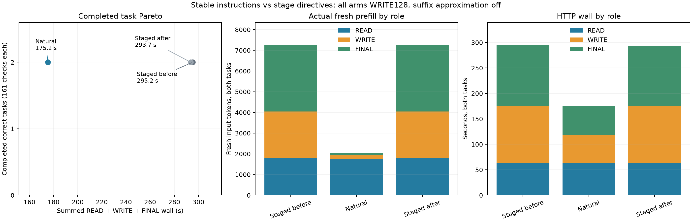

# Stable instructions through tool turns

**Natural instructions reduced the completed two-task wall time by 40.49%**, from the staged bracket mean of 294.465 s to 175.231 s. Ledger saved 33.18%; LRU saved 49.71%. All six first implementations passed 161/161 checks and the READ→WRITE→FINAL contract, with no caps.

| Arm | Ledger / LRU wall, s | Total task wall, s | Thinking / output tokens | Cached / fresh input tokens |
|---|---|---:|---|---|
| Staged before | 164.813 / 130.424 | 295.237 | 725 / 1648 | 0 / 7262 |
| Natural | 109.728 / 65.503 | 175.231 | 1165 / 2101 | 5083 / 2053 |
| Staged after | 163.603 / 130.089 | 293.693 | 725 / 1648 | 0 / 7262 |

The after bracket was 0.523% faster than before. Both staged tasks repeated identical first code bytes, final text, grade and per-role usage. Natural decoded different histories and **more thinking**, while avoiding most subsequent prefill.



| Role, both tasks | Staged mean HTTP, s | Natural HTTP, s | Staged fresh tokens | Natural cached / fresh tokens | Thinking staged / natural |
|---|---:|---:|---:|---|---|
| READ | 63.489 | 63.468 | 1790 | 0 / 1738 | 39 / 68 |
| WRITE | 111.336 | 55.269 | 2260 | 1997 / 228 | 256 / 256 |
| FINAL | 119.637 | 56.492 | 3212 | 3086 / 87 | 430 / 841 |

Actual server context spans confirm the natural hits: ledger WRITE `1014..1190:176` and FINAL `1636..1680:44`; LRU WRITE `983..1035:52` and FINAL `1450..1493:43`. Staged starts each request at 0. Each WRITE forced once at 128; all 18 summaries report zero deferrals. READ/FINAL remain budget 0 with high thinking enabled.

The single caller change keeps exactly `task.system` as instructions on every natural request. Staged adds changing READ/WRITE/FINAL directives. Both use the same original full user contract, tools, advertised paths, observer, frozen [item17 fixtures/graders](../server-confirmation-hour17-20261004/practical/check-results.json), and stored response continuations. No retries or code repairs. Task wall includes actual HTTP/file I/O and excludes startup/grading.

This is an **instruction-protocol comparison**, including shorter initial prompts and different generated histories. Suffix approximation is off; the observed reuse is ordinary exact prefix caching. The gain cannot be added to items 16/17, and divergent histories receive no paired NLL/KL. There is no natural budget 0 arm here.

Runtime `bc6896ae` and server SHA are pinned in [build.json](build.json). All arms use WRITE 128, Q2/cache64/ctx8192/chunk512, temperature 0/high thinking, GAP0/TILE64/LIMIT1024, fresh cache/store lifetimes, and the shared 2048 output allowance. Output usage excludes EOS; public completion is not a separately observed EOS token. Nonzero WRITE budget disables MTP for that request in every arm.

```sh
.workspaces/bench-plots-venv/bin/python -B speed-bench/experiments/stable-instructions-hour18-20261004/analyze.py --input speed-bench/experiments/stable-instructions-hour18-20261004/http --output speed-bench/experiments/stable-instructions-hour18-20261004/analysis --plot
```

[Guard](guard/result.json) completed with code 0: 744 samples, all level 1, zero bad streak, stable swap 0.012998 GiB, peak wired+compressor 84.718 GiB. [CSV](analysis/results.csv), [JSON including repeat and context evidence](analysis/results.json), [SVG](analysis/protocol-pareto.svg), [launch command](guard/command.json) and [raw HTTP arms](http) retain all results. Stable continuation instructions merit further realistic-agent qualification; the two-task screen does not establish general reliability.
