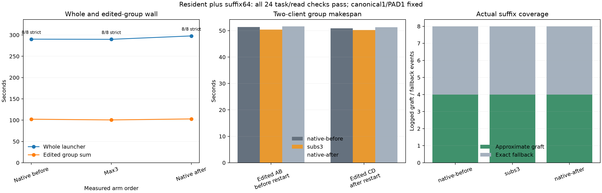

# Resident routing with qualified suffix reuse

Adding the strong resident profile preserved **24/24 task grades and actual file reads**, with no caps. Its **1.42% lower whole wall** against the native bracket mean is smaller than the **2.60% native bracket drift**. This screen supports compatibility; it does **not establish a useful additional whole-workflow speed gain**.

| Arm | Whole launcher, s | Warm AB / CD, s | Edited AB / restarted CD, s | Edited sum, s | Strict / reads |
| --- | ---: | --- | --- | ---: | --- |
| Native before | 290.226 | 91.012 / 90.658 | 51.389 / 50.897 | 102.285 | 8/8 / 8/8 |
| Max3 resident | 289.840 | 90.106 / 94.887 | 50.350 / 50.202 | 100.552 | 8/8 / 8/8 |
| Native after | 297.780 | 94.800 / 95.428 | 51.645 / 51.278 | 102.922 | 8/8 / 8/8 |

Resident whole wall changed −0.13% against native-before and −2.67% against native-after (−1.42% against their mean). Edited-group sum changed −2.00% against the mean; native edited drift was +0.62%. Warm AB/CD drifted +4.16%/+5.26% between controls. Resident client-phase wall was actually 0.56% longer than native-before, despite its slightly shorter whole launcher wall. Startup/shutdown and warm variation matter at this scale.



Native public outputs, function argument strings and each response's usage repeated exactly after excluding generated item/call IDs. The candidate retained every warm output and every edited first call. Its only public change was B's final JSON spacing, reducing output by three tokens; the facts stayed correct. All four edited totals/codes matched independent gold, including C/D's updated `CEDAR-70` / `DELTA-83` after restart. These effort-none records report zero reasoning tokens; generated token IDs and private replay were not exported, so this is public-byte and usage-count evidence.

Each arm used its own fresh cache namespace and warmed source states under its **own routing policy**. Settings were unchanged across its restart, and the same per-history request hints were used. Every arm logged four primary grafts from suffix-native sources (`source_approximate=0`, `source_ssd=1`), no completion grafts, and four approximate `visible-prefix` continuations retaining 1,530 tokens with 25–26 fresh. All grafts reused 1,034 tokens with fresh95: A/C source `660:1694` → `308:1342`, no pad; B/D source `658:1692` → `308:1342`, pad1. Here “suffix-native” means the source was not previously suffix-grafted; the resident arm's source was still computed using resident routing. Group log slices are counted once, preserving concurrent attribution.

Routing was active, rather than a no-op: its two server lifetimes reported **13,697 substitutions across 32,520 layer calls**, 18,032 native misses, 1,984 double-substitution layers, 190 triple layers and zero drops. Native coefficient preservation was requested and reported for all substitutions. Phase mean replaced mass was 0.12393/0.12818 and mean affinity ratio 0.90071/0.89946. The skipped-load counter estimates 136.330GB of tensor bytes; this is not measured physical SSD traffic. All arms had 330 logical disk chunk-read operations, zero hot reads/endpoint evictions, four slot evictions and four initial exact fallbacks. Final SSD ownership was approximately 640MB in each arm, with minor chunk differences.

Only routing settings changed: native GAP0/native-weights0 versus replace/GAP0.90/max-mass0.25/rank64/max-subs3/total-mass0.50/native-weights1. Qualified canonical1/PAD1/suffix64 continuation, hot0/SSD4096MiB, Q2 cache64GiB, two resident slots/two clients, context8192/chunk512, tile64/limit1024, temperature0/effort-none, visible files and first attempts stayed fixed. Whole launcher includes both startups, client phases and shutdowns. Edited group makespans include client waiting; summing individual queue-inclusive durations does not measure elapsed wall or parallel GPU throughput. One edit per history was tested. There is no additive speed claim or paired NLL for these generated histories; resident settings remain opt-in.

Runtime `91c9cf21` and exact server SHA/settings are in [build.json](build.json). Raw HTTP/server records and guarded commands remain under each arm and `guard-*`. All guards returned child0: **848 samples**, all pressure level1, stable 0.012998GiB swap, peak wired+compressor85.012GiB, no bad-pressure streak.

```sh
.workspaces/bench-plots-venv/bin/python -B speed-bench/experiments/suffix-resident-package-hour26-20261004/analyze.py --input speed-bench/experiments/suffix-resident-package-hour26-20261004 --output speed-bench/experiments/suffix-resident-package-hour26-20261004/analysis --plot
```

[JSON/CSV evidence](analysis/results.json) retains independent grades, actual role usage, public comparisons, suffix geometry, route summaries, cache counters and pressure. The next useful decision needs a task with more resident-sensitive decoding; this small gain does not justify default promotion.
